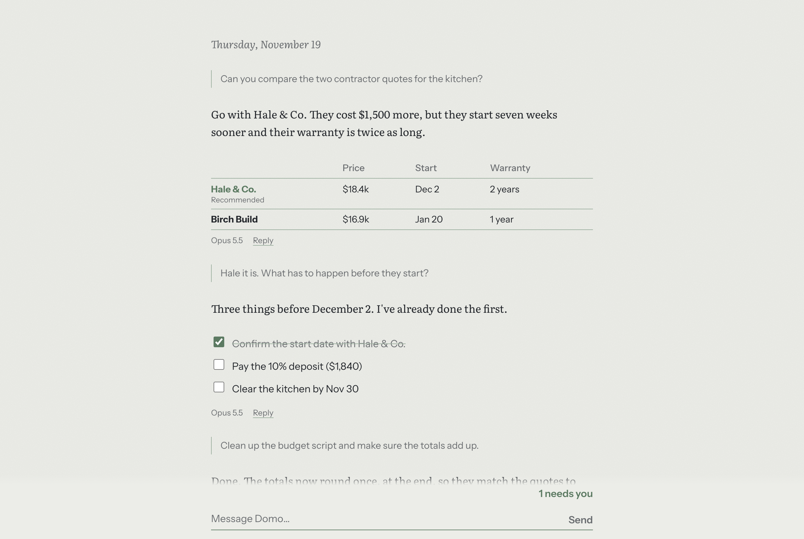
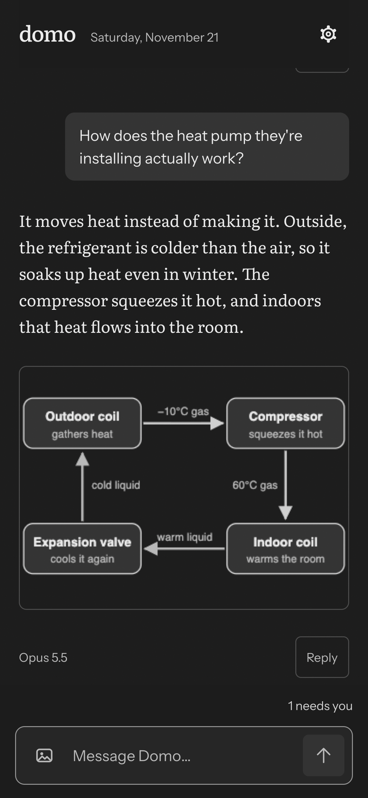
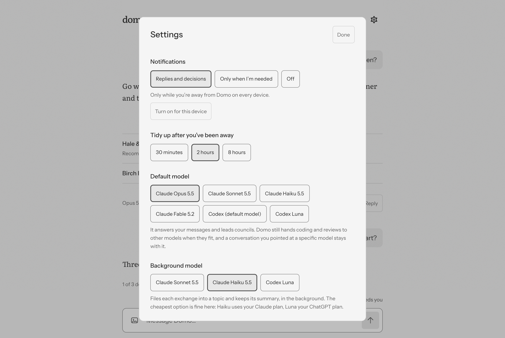

# Domo

A personal chief of staff that runs on your own Claude Code and Codex subscriptions.

Domo is one calm chat. Behind it, a small daemon on your Mac routes each message to the right model, from either provider. It runs councils of mixed models, remembers what matters, and keeps working while you're away. You talk to it from your laptop or your phone. You never pick a model, manage threads, or file anything yourself.

<p align="center">
  
  
</p>

> **Status:** early and personal. It's built and used daily on macOS by one person. Expect rough edges and breaking changes.

## What it does

- **One conversation.** No thread lists, tabs or sidebars. Domo files each message into a topic behind the scenes and resumes the right session. While you're away, it tidies finished topics into an "Earlier" fold. Every tidy can be undone.
- **Both providers, one team.** Opus 5.5 leads by default. Any Claude or Codex model can take over or be handed work (`delegate`), several can debate and converge (`council`), and long jobs run in the background.
- **Intelligent UI instead of walls of text.** Five components: Choice, Comparison, Checklist, Work receipt, and Visual. A Visual is agent-drawn HTML (diagrams, explainers, small calculators) that runs in a sandbox. Domo renders and reviews each one before you see it.
- **Memory that stays useful.** It keeps a short always-loaded profile and one fact per note, with full-text recall. A nightly consolidation merges duplicates, retires stale notes, and commits everything to a git repo in `~/.domo`. Restatements carry a source tag that opens the original messages.
- **High autonomy, hard guardrails.** It edits files and runs commands without asking. Pushing, publishing, deleting outside a project, sending on your behalf and spending money always go through an approval in the chat.
- **Improves itself.** The Lab turns friction (rephrasing, "more" taps, undone tidies) into one small skill edit. It replays your recent exchanges, and the other provider judges blind. The edit is kept only if it wins, and it's rolled back if things get worse.
- **Desktop and phone.** It installs as a web app over [Tailscale](https://tailscale.com), with push notifications only when a decision is blocked on you.

## How it works

```
Phone / laptop browser ──(tailnet HTTPS + access token)──▶ Domo daemon on an always-on Mac
                                                            ├─ Conductor: routes, runs turns and background tasks
                                                            ├─ DomoMcp: one MCP server both providers call
                                                            │    (components, delegate, council, ask_user, memory, goals)
                                                            ├─ Providers: Claude Agent SDK + Codex SDK (your local logins)
                                                            ├─ Memory, Tidier, Lab, Notifier, VisualCheck
                                                            └─ SQLite (FTS5) + ~/.domo (a git repo: profile, notes, skills, ledger)
```

It's written in TypeScript on Node 24 with [Effect 4](https://effect.website), React 19 and Vite. [`AGENTS.md`](AGENTS.md) is the full guide to the design and conventions.

## A note on subscriptions and terms

Domo drives the `claude` and `codex` command-line tools that are already signed in on your machine. It never sees or stores your credentials. Whether a provider's consumer subscription may be used this way is set by that provider's terms, which change. Check the current terms for Claude and for ChatGPT/Codex before relying on it. If you prefer API billing, set `DOMO_AUTH=api-key` and Domo will pass your `ANTHROPIC_API_KEY` through.

## Requirements

- macOS (the only platform tested; Linux will likely work for the daemon)
- [Node.js 24+](https://nodejs.org) and [Bun](https://bun.sh) (Bun is only the package manager)
- [Claude Code](https://docs.claude.com/en/docs/claude-code), signed in (`claude auth login`)
- [Codex CLI](https://github.com/openai/codex), signed in (`codex login`)
- Optional: Google Chrome, so Domo can check visuals before showing them
- [Tailscale](https://tailscale.com), to use Domo from your phone or any other computer. It's how they reach Domo, over the HTTPS that installing the app and push notifications need. You can skip it only if you'll use Domo in a browser on the Mac it runs on.

## Quick start (one machine)

```bash
git clone https://github.com/dhannusch/domo.git && cd domo
bun run setup    # installs, builds the app, and puts a `domo` command on your PATH
domo init        # creates your agent home in ~/.domo
domo doctor      # checks your Claude and Codex logins
domo serve       # starts Domo on 127.0.0.1:7420
```

Then, in another terminal, print the link that unlocks the app on this machine:

```bash
domo pair
```

`domo` is a small wrapper around this checkout, so `git pull` updates it. Rerun `bun run cli` if you switch Node versions. `domo ask --model codex:default "…"` sends one message to any model from the terminal.

## Always-on host, with your phone and laptop

Run Domo on one always-on Mac (a Mac mini is ideal). Sign in to Tailscale, Claude Code and Codex on that Mac, then:

```bash
sh scripts/setup-host.sh
```

This installs and builds Domo, keeps it running at login (launchd), and serves it on your tailnet over HTTPS. Then it prints pairing links. On your iPhone, open the link and choose Share › Add to Home Screen. On a laptop, open it in Chrome and choose Install. Clients install nothing else. All agent work, coding included, happens on the host.

There's nothing to pair on your own devices. Domo lets in anything signed in to Tailscale as the account that owns the host. Everything else needs the access token from `domo pair`, such as a shared device or another tailnet member. Set `DOMO_TAILSCALE_USERS` to list other logins to let in, or `off` to always require the token.

The daemon only ever listens on `127.0.0.1`, so Tailscale is the only way in from another device.

## Updating

```bash
domo update --check   # what's new on GitHub, without changing anything
domo update           # pull, install, rebuild, restart, and confirm Domo is healthy
```

Your conversation, memory and settings live in `~/.domo` and carry over, and database changes apply on their own. If installing, building or the restart fails, `domo update` puts the previous version back and restarts it. It won't touch a checkout with local edits or local commits, so the host only ever moves forward from GitHub. Reload the app on your devices afterwards to get the new interface.

## Settings

<p align="center"></p>

Tap the date at the top of the chat. From there you can change notifications, how long Domo waits before tidying, and whether the Lab runs. You can also see (and undo) what the Lab changed, read what Domo knows about you, and list your devices. Or just tell Domo, for example "no notifications after 10pm".

| Variable | Default | Meaning |
|---|---|---|
| `DOMO_HOME` | `~/.domo` | Agent home: database, memory, skills, Lab ledger, token |
| `DOMO_PORT` | `7420` | Port on `127.0.0.1` |
| `DOMO_AUTH` | `subscription` | `subscription` (local CLI logins) or `api-key` |
| `DOMO_PROVIDER` | `live` | `echo` is a deterministic fake for tests |
| `DOMO_TOKEN` | from `<home>/token` | Access token; `off` disables it (tests only) |
| `DOMO_TAILSCALE_USERS` | the host's owner | Tailscale logins let in without the token (comma-separated), or `off` |
| `DOMO_AWAY_SECONDS` | `7200` | Default away clock (the settings sheet overrides it) |
| `DOMO_VISUAL_CHECK` | `on` | Render and review visuals before showing them |

## Development

```bash
bun run check          # Biome, tsc, and unit tests (no live models)
bun run test:e2e       # builds the web app, then Playwright against echo daemons
bun run serve          # daemon on 127.0.0.1:7420
bun run dev:web        # Vite on 5173, proxying /rpc to the daemon
bun run screenshots    # regenerates the README images from a fictional demo conversation
```

Use `--home ~/.domo-dev --port 7421` while developing, so test chats stay out of your real agent home. Tests never call live models: the echo provider understands directives like `[[choice]]`, `[[visual]]` and `[[council]]`, and drives the real MCP path end to end.

## Contributing

Contributions are welcome. Read [`CONTRIBUTING.md`](CONTRIBUTING.md) and [`AGENTS.md`](AGENTS.md) first: the product principles there (one chat, nothing moves while you're looking, prose first) are deliberate. `constitution.md` and `evals/rubric/` are human-owned guardrails. Domo's own self-improvement loop may never edit them.

## Security

See [`SECURITY.md`](SECURITY.md) for the threat model and how to report a vulnerability.

## License

[MIT](LICENSE)
